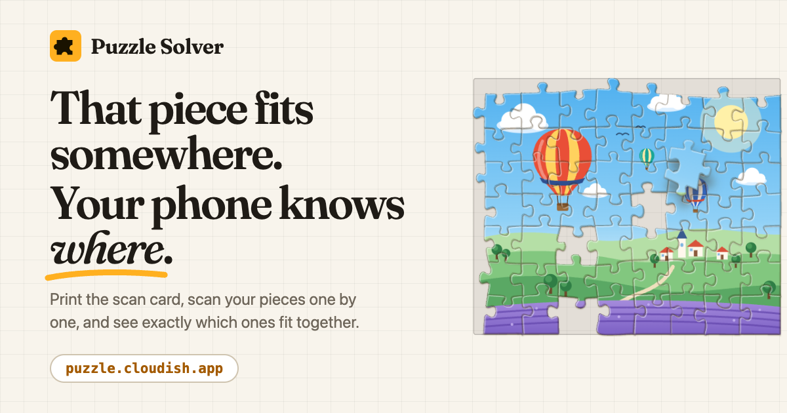
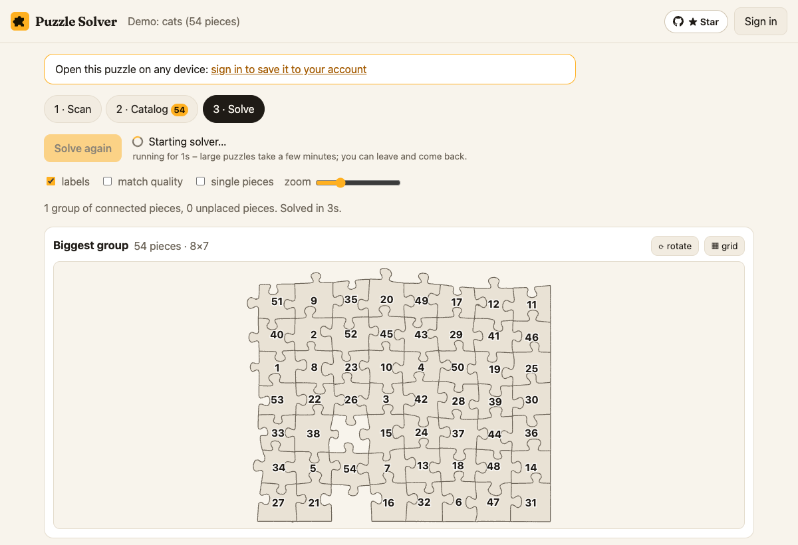

# Puzzle Solver

A jigsaw puzzle solver for your phone. Live at **https://puzzle.cloudish.app/**

[](https://puzzle.cloudish.app/)

Scan jigsaw pieces one at a time with a phone camera on a printed scan card. The app traces each
piece's exact outline on the device and stores only that 2D contour plus a label. The Node server
finds every piece's four sides (tab, blank or flat edge), matches sides geometrically, and
assembles the catalog into groups.

The first version used [byWulf/jigsawlutioner](https://github.com/byWulf/jigsawlutioner) (PHP)
for analysis and solving. With the accurate contours from the scanner, a direct geometric
comparison of sides works better. The server is now plain Node with no dependencies.
jigsawlutioner's results served as the reference to validate the new corner finder and solver.

## Using it

1. **Print the [scan card](public/card.html)**, a 70 mm black frame. It is required: it corrects
   perspective and gives every piece its true size in mm.
2. **Scan.** Put one piece in the middle of the card and hold the phone flat so the card fills the
   view. When the frame turns green and you hold still, the photo is taken automatically. You can
   also tap ●, or use 🖼 to take the photo with the phone's camera app (full resolution, flash).
   Labels count up from 1, and you can edit them.
3. **Review**, write the number on the back of the piece, then tap *Next piece*.
4. **Match / solve.** Open a piece to see what fits each side, or solve the whole catalog.



The demo on the start page (54 real pieces, traced from flatbed scans) solves into a single group in
a few seconds, as above. It's the bottom-right corner of a larger puzzle, and two of its pieces are
missing from the set.

The light (torch / flash) is switched on automatically where the browser allows it. The scanner
waits for the phone to be flat (within 3°) and for the card to fill the view, and explains what is
missing if that takes longer than 5 seconds.

## How the scanner works (all on the device)

| Stage | Where | What |
|---|---|---|
| Live view | `public/scan/live-worker.js` | Only finds the card, ~3×/s on a 320 px frame. The camera runs at 15 fps and a motion-sensor level shows tilt. The piece is not segmented live: continuous segmentation overheated phones. |
| Capture | `public/scan/scanner.js` | Native photos via `ImageCapture.takePhoto()` (with flash) where available, otherwise the highest-resolution video frames. The camera is switched off while processing and reviewing. |
| Card | `vision.detectCard` | Ring found in the downscaled photo; corners refined by line fitting; homography to mm. |
| Coarse mask | `vision.segmentOnCard` | On the blanked card interior, with a **shadow-free distance**: the pixel is written as I = s·B + r against the local card color B. Shadows (s < 1, r ≈ 0) score zero; the piece differs in color (r) or is brighter. |
| Edges | `vision.refineOnCard` | At the photo's native resolution around the piece: α = (D(I) − n) / (D(F) − n), using the shadow-free distance D, the nearest piece color F and the card color averaged over the plain card. The 0.5 iso-line is traced with marching squares, then smoothed by 0.08 mm along the outline. |
| Combine | `refine-worker.js` | Frames are aligned and averaged; blurred frames are dropped first. |

On the six test photos (`tests/test1`), the new pipeline excludes the shadow crescents the old
one included: its outlines were 7–9% too large in sqrt(area). Jitter is about 35% lower, and all
side types (tab / blank) are detected correctly. On synthetic bursts with ground truth, the
outline error is about 0.25% of piece size.

## Server (Node, no dependencies)

| Part | What it does |
|---|---|
| `server/piece.js` | Finds the four corners: sharp convex turns, choosing the four that form the most rectangle-like quad whose sides start and end straight. Splits the outline into sides in their own frame, classifies each side (flat / tab / blank) and samples it for matching. Agrees with jigsawlutioner on all 54 demo pieces (same side types, corners within 0.2 mm). |
| `server/match.js` | Geometric side matching. Side B is mated onto side A (flipped and reversed, as two real neighbours meet), then a rigid ICP fit is run that also allows a **uniform gap**: photos show the slightly rounded top edge, so true neighbours sit about 0.3 mm apart along the whole edge. The score is the remaining shape mismatch in mm, plus a penalty for a gap far from the puzzle's typical one, which is estimated from mutual-best fits. |
| `server/solver.js` | Constrained assembly. Links are processed strongest first (mutual-best and clear winners ahead). Two groups merge only if every pair of pieces that ends up side by side fits, no cells collide and no flat edge faces a neighbour. When two groups agree along many good contacts but conflict in a few places, the weaker pieces are evicted and may re-attach later (local backtracking). |
| `server/store.js` | JSON files per puzzle under `$DATA_DIR/puzzles/<id>/`. Pieces from the PHP version are re-analyzed from their stored contours. |
| `server/index.js` | HTTP API + static files. Solving runs in a worker thread (`server/solve-worker.js`). |

Results against ground truth (jigsawlutioner's verified solutions of the sample sets):

| Set | Pieces | Biggest group | Neighbour pairs correct (precision) | Found (recall) | Time |
|---|---|---|---|---|---|
| cats (demo) | 54 | 54 | 100% | 100% | ~1.5 s |
| paris | 500 | 489 | 99.8% | 97.1% | ~20 s |

On the six real pieces from `tests/test1`, the measured typical gap is 0.31 mm. The solver
assembles a 2×2 block and a separate pair, consistent with the test 2 feedback.

### API

```
POST   /api/puzzles                       {name}                                 -> catalog
GET    /api/puzzles/:id                                                          -> pieces, next label, solve status
POST   /api/puzzles/:id/pieces            {label, contour, sizeMm, quality?, replace?} -> analyzed piece
PATCH  /api/puzzles/:id/pieces/:n         {label}
DELETE /api/puzzles/:id/pieces/:n
GET    /api/puzzles/:id/pieces/:n/matches                                        -> best candidates per side (gap in mm)
POST   /api/puzzles/:id/solve                                                    -> starts the solver
GET    /api/puzzles/:id/solution                                                 -> status + groups
GET    /api/puzzles/:id/export                                                   -> labels + contours (JSON)
```

## Landing page

The start page (`public/index.html`, styles in `public/style.css`) is static HTML, so search engines
and link previews can read it. `public/app.js` hides it on puzzle pages and swaps its calls to
action once the account is known. Headings use [Fraunces](https://github.com/undercasetype/Fraunces)
(OFL, self-hosted in `public/fonts/`).

Its illustrations (`public/landing.js`) are drawn from real data rather than mock-ups:
`public/demo/landing.json` is the 54-piece demo as this app analyzed and solved it, with outlines in
millimetres where the solver placed them. The picture on the pieces is `public/scene.svg`. The hero
assembles the solved board from a pile, and the step illustrations follow one piece (42) with its real
neighbours and match confidences. The hero pieces are HTML layers clipped to their outlines, so the
animation moves cached layers instead of repainting the picture every frame.

## Running locally

```bash
PORT=8080 DATA_DIR=./data node server/index.js
```

## Deploying

`./deploy.sh` uploads the build context to [Cloudish](https://cloudish.ai), which builds the image
and rolls it out. It needs `CLOUDISH_API_KEY` in `.env`.

## Tools

- `tools/make_demo_catalog.py`: builds the demo catalog (`public/demo/cats.json`) from a
  [jigsawlutioner-cli](https://github.com/byWulf/jigsawlutioner-cli) sample set.
- `tools/make_scan_frames.py`: synthetic camera bursts with ground truth on the scan card (`TURN=1` also writes a 180°-turned placement).
- `tools/make_landing_data.mjs`: imports the demo into a running server, solves it and writes `public/demo/landing.json` for the landing page's illustrations.
- `tools/make_social_card.mjs`: renders the 1200×630 link preview (`public/social-card.png`) from the landing page's art, with Playwright and Chrome against a running server. Re-run it when the headline or art changes.
- `tools/make_scan_video.py`: a fake-webcam MJPEG video for Chrome's `--use-file-for-fake-video-capture` (`CARD=dark` puts the pieces on the card).

## Credits

[jigsawlutioner](https://github.com/byWulf/jigsawlutioner) and
[jigsawlutioner-cli](https://github.com/byWulf/jigsawlutioner-cli) by Michael Wolf (MIT): the
original analysis/solver, the reference results used for validation, and the demo pieces.
[Fraunces](https://github.com/undercasetype/Fraunces) by the Fraunces Project Authors (OFL) for
headings. Hosted on [Cloudish](https://cloudish.ai).
